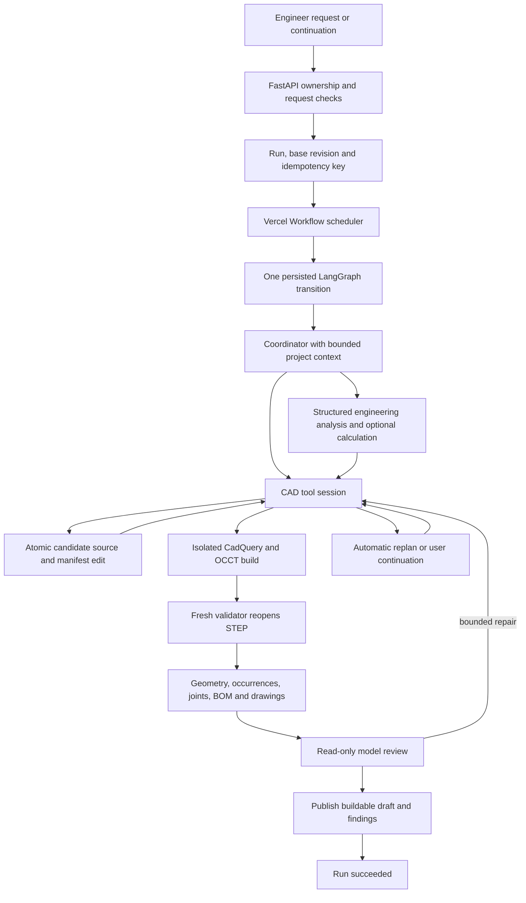
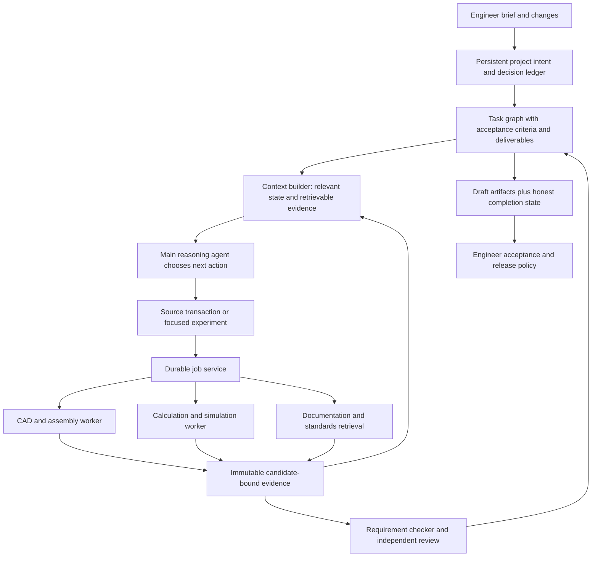

# Forma backend and agent architecture review

Reviewed 22 October 2026. Source baseline: `c9205e1`, branch `codex/cad-observation-budget-20261022`, checkout `D:/v1/_worktrees/forma-harness-v25`.

## Executive assessment

**Forma is repairable, but a more intelligent model alone will not make the current system reliable on difficult mechanical designs.** It already has important infrastructure: durable graph checkpoints, isolated native CAD execution, atomic source edits, independent STEP reopening, candidate-bound evidence, assembly solving, BOMs and drawing exports. Keep these investments.

The principal problem is the contract between design intent, agent work, scientific evidence and completion. Today that contract is spread across chat excerpts, optional agent notes, a small requirement schema, many recovery conditions and draft-publication rules. A long run can preserve its Python files while losing an earlier engineering decision, repeatedly build without resolving the underlying hypothesis, or finish with a downloadable draft that still fails the user's task.

My recommendation is an incremental redesign around **a persistent engineering project record, a small general agent loop, reusable diagnostic tools, and evidence-backed task completion**. The agent should choose its construction and repair strategy. The backend should enforce ownership, numerical integrity, resource budgets and honest evidence. Do not add pump-specific recipes or more keyword-based engineering answers.

This is an architecture review, not a new pump qualification or deployment. No production configuration or application source was changed for this review. The report includes five offline reproductions and the existing backend regression suite. The last recorded hosted pump run was paused with no published geometry; that recorded status was not refreshed against production here.

## What was inspected and tested

The review traced the web submission/resume entry points, FastAPI routes, project context retrieval, LangGraph state and transitions, Vercel scheduling, operation ledger, provider adapters, editing tools, engineering analysis, CAD build/validation, native assembly and inspection code, BOM/drawing generation, publication SQL and relevant tests. It also checked the architecture and release records. This is a focused end-to-end review of the important execution paths, not a claim that every line or enterprise failure mode has been exhaustively audited.

- **388 existing API tests passed in 11.13 seconds** at the baseline above. They principally exercise mocked services and deterministic contracts; they do not establish autonomous completion of hard CAD tasks.
- **Five offline behavior probes reproduced the findings below.** Database and model calls were mocked. Results: [review evidence](FORMA_AGENT_ARCHITECTURE_REVIEW_EVIDENCE_20261022.json). Reproducer: [review_architecture_probes.py](../scripts/review_architecture_probes.py).
- A separate arithmetic check evaluated the pump's specified tolerance intervals and inventory. It did not inspect generated geometry.
- Initial sandboxed test launches stalled while Windows initialized Python's local event-loop socket pair. A minimal diagnostic isolated that environment restriction. Those launches were stopped; the suite and probes passed outside that restriction. This was not a Forma test failure.
- No new live LLM comparison, hosted acceptance, native-kernel benchmark, crash-injection campaign or multi-tenant load test was performed. Conclusions requiring those tests are marked as risks or proposed gates.

The older assembly release note says drawings were missing at that release. Current source and the later [drawing release record](FORMA_DRAWING_RELEASE_PROGRESS.md) include draft views, dimensions, GD&T annotations and SVG/PDF/DXF exports. It would be incorrect to treat all drawing support as absent today. Annotation support does not mean manufactured-part GD&T verification.

## 1. How the current backend actually works

The graph is a real tool loop, not a single generation request. Within CAD it supports incremental source edits, component probes and assembly milestones. Engineering is different: the active `engineering_analysis` node asks for one structured analysis, optionally executes its Python calculation, then returns. The broader engineering tool list in `tools.py` does not turn that active node into a continuing scientific investigation.

Useful existing boundaries:

| Existing mechanism | Why it matters | Boundary of the evidence |
|---|---|---|
| PostgreSQL graph checkpoints and external-operation ledger | Preserve work through bounded transitions and avoid blindly repeating uncertain calls | They are not a complete persistent engineering specification or an atomic transaction across all services |
| Atomic source/manifest validation, stable IDs, rejected-source retrieval | Prevent broken partial edits from replacing saved source | Strict consistency of a build candidate should not become a requirement that an entire project be authored at once |
| Isolated builder, denied network, restricted worker environment | Generated CAD code is separated from service credentials | Production isolation still needs recurring security and resource testing |
| Fresh STEP validator and candidate/requirements/runtime identity | Checks exported geometry without trusting generated Python assertions | It measures only implemented properties; valid B-reps do not imply a correct pump |
| Native joint residual/DOF and occurrence checks | Stronger than accepting a solver's success flag | Declared datum frames still need to correspond to the intended geometric axes/faces |
| BOM/drawing generation from validated geometry | Useful downstream artifacts already exist | Draft output is not approval for manufacture |

Entry points: [workspace.tsx:351](../apps/web/src/components/workspace.tsx), [api.py:190](../apps/api/forma_api/api.py), [runner.py:24](../apps/api/forma_api/graphs/runner.py), [design.py:3163](../apps/api/forma_api/graphs/design.py), [engine.py:234](../apps/api/forma_api/engine.py), [forma_runtime.py:148](../runtimes/python/forma_runtime.py).

## 2. Findings, ordered by impact

P0 means fix before trusting unattended engineering results. P1 means necessary for credible difficult-task and organizational pilots. P2 means subsequent capability/scaling work. These priorities are recommendations, not severity claims about an exploited security incident.

| ID | Priority | Finding | Evidence level |
|---|---|---|---|
| R1 | P0 | A keyword match substitutes a fixed engineering calculation for different input numbers | Reproduced |
| R2 | P0 | Cross-run context can omit original requirements and older human corrections | Reproduced |
| R3 | P1 | Engineering cannot reliably iterate on the current measured candidate | Handoff omission reproduced; limits confirmed in source |
| R4 | P1 | Recovery constrains action choice without establishing that the diagnostic work is sufficient | Source-confirmed policy; effect on completion requires controlled comparison |
| R5 | P1 | Draft publication and task completion are different concepts but share a successful terminal path | Reproduced, intentional current behavior |
| R6 | P1 | Requirement checks and inspection tools cannot prove much of a complex engineering brief | Confirmed in contracts/runtime |
| R7 | P1 | Provider qualification, context sizing and model provenance are insufficient for fair diagnosis | Source and recorded operational evidence |
| R8 | P1 | Workflow persistence is useful, but scaling and write fencing need stronger boundaries | Global queue confirmed; crash/lease hazards need fault injection |
| R9 | P1 | History exists in several stores but the agent cannot retrieve a complete experimental history | Working-memory behavior reproduced |
| R10 | P1 | Passing unit tests are not a measured hard-design success rate | Current coverage and release evidence |

### R1. Remove the hard-coded engineering answer

`deterministic_tolerance_calculation_source()` in `graphs/design.py:171` checks for the words spacer A/B/C, end-float and tolerance, then returns fixed numbers: a 50 mm gap and 20/15/14.9 mm spacers. It does not extract or validate the user's numbers. `engineering_analysis()` selects this path before asking the model.

**Reproduction:** ask for three 10 mm spacers in an exact 40 mm gap. Correct nominal end-float is `40 - (10 + 10 + 10) = 10 mm`. The function instead uses its built-in 50 mm gap and reports **0.10 mm**.

This can produce a repeatable but wrong engineering report. It also conflicts with the goal of a general AI-native application. Replace it with a general, unit-aware interval calculation facility whose inputs carry links to the actual request. Keep examples as test fixtures, never as hidden runtime answers. Re-running the same wrong formula twice cannot validate its meaning.

### R2. Durable state is not yet durable design intent

`repositories/projects.py:54` fetches recent chat plus the first brief. It truncates the original brief to 12,000 characters, retains only eight human corrections in `authoritativeInputs`, and keeps a bounded recent dialogue. The agent has no general tool to page older project messages back in. A new run's working notes are not automatically loaded from an earlier run.

**Reproduction:** a requirement at the end of a 12,035-character first brief disappears; an early correction followed by 15 later notes also disappears from the assembled context. In-run `user_updates` preservation is useful and its tests pass, but it does not solve cross-run retrieval.

Use an immutable original brief plus an ordered decision/requirement ledger. Never depend on the last eight messages to preserve a dimension. Each amendment needs a source message ID, scope, superseded value and effective version. Context should retrieve the relevant entries; the underlying data remains available in full. A summary may omit a fact from the current prompt, but must not make it unreachable.

### R3. Engineering is a one-shot handoff with insufficient measurement access

`design.py:1026` constructs the analysis packet from requests, project context, remarks and working memory. It does not automatically include the current candidate manifest, current validation report or current build measurements. A previous accepted revision can be present in project context, which is not equivalent to the current candidate.

**Reproduction:** a current measurement placed in `validation` and `build_result` does not appear in the analysis packet. A CAD agent could manually copy it into its delegated text, but the harness does not guarantee its identity or transfer.

Further restrictions make hard work difficult:

- `request_engineering` in `design.py:2217` allows only two requests per run; later calls are rejected even after meaningful new geometry.
- CAD cannot read a `calculations/` file once an engineering summary exists (`design.py:2012`). Preventing edits across roles is understandable; preventing read-only inspection removes useful evidence.
- The active engineering node has structured-answer correction, but no continuing inspect/edit/calculate/compare loop for a failed computation.
- A successful calculation can return a conclusion saying a check failed, while the summary is prefixed with “Calculation verified”. The established property is execution/reproducibility, not engineering correctness.

Make analysis a general sandbox-backed tool session with access to the exact candidate's read-only geometry and measurements. Return a structured report containing formula, inputs, units, source references, candidate hash, results and unresolved checks. Allow further analysis when inputs or the hypothesis change, within the run's real budget. A calculation and its CAD consumer must share versioned parameters.

### R4. Recovery contains restrictions that can force an unhelpful next step

The current CAD loop has useful protections, but also interacting heuristics:

- Three observation-only decisions can hide reading tools (`harness.py:9`, `design.py:1762`). Three decisions are not necessarily enough to inspect a multi-part defect.
- After an edit following an active full-build failure, only `build` is offered (`design.py:1842`). The agent cannot then inspect another dependency, complete a second related edit or run a diagnostic before a full rebuild.
- Contract-repair mode replaces the tool set with edit/read/search actions (`design.py:1825`), excluding explicit task notes or a genuine clarification.
- Recovery is bounded to six plans overall and two for a candidate/failure key (`design.py:2845`); model calls default to 24 per continuation cycle. These are guardrails against runaway work, not evidence that a difficult engineering task is intrinsically impossible.
- User permission to make assumptions is detected by phrases, then acknowledges any question passed to that helper (`design.py:2651`). It does not classify whether that particular missing value is covered by the permission.

These rules explain a plausible loop: incomplete diagnosis → forced full build → same error → reset/replan → limited source view → another partial repair. That causal effect needs an ablation test; source inspection alone does not prove it caused every historical failure.

Replace action-count restrictions with a progress policy: identify the current defect, record a proposed cause, choose the smallest experiment that can distinguish causes, compare the result, then retain or reject the hypothesis. Keep reads and scoped diagnostics available. Exact duplicate requests can return a cached receipt. Escalate or pause for repeated absence of new evidence, unavailable capability, budget exhaustion, or an actual human decision. Do not require a full expensive assembly rebuild after every source change.

### R5. A buildable draft is being used as the terminal unit of success

`record_review_result()` (`design.py:1464`) converts repair to publish after a repeated finding or two review repair cycles. `engine.py:288` treats requirements as advisory, and the publication SQL deliberately allows failed requirement checks. `final()` defaults to run status `succeeded`.

**Reproduction:** a known wrong bore remains an error finding after two repairs, yet the next phase is `publish`. The finding remains visible; this is not concealed validation. The missing concept is the outcome of the complete requested task.

Keep draft availability. Add independent states: `working`, `draft_available`, `blocked`, `ready_for_engineering_review`, and `accepted/released` under an explicit release policy. A run may produce a useful draft and still be incomplete. Each requested deliverable must have an evidence-backed outcome. A model review budget expiring should not satisfy a requirement.

### R6. The tools do not yet expose the evidence a hard task needs

`Requirement.kind` (`contracts.py:361`) covers dimensions, maximum envelope, bounding-box center, solid count, a constrained through-hole/corner-radius set, assembly preservation and unverified items. General inspection adds surface inventory, mass, pairwise interference/distances and configurations. This is useful but cannot establish involute accuracy, backlash, complete tolerance chains, casting draft/minimum wall, thread-standard compliance or mechanical performance.

`inspect_geometry` retrieves an existing report; it is not an arbitrary, scoped geometry measurement tool. For example, a minimum distance between two whole shapes is not automatically the radial tip clearance or backlash requested by the engineer.

Other concrete boundaries:

- Native assembly supports a qualified joint subset and at most 100 movable occurrences for the current DOF check. Gear/contact dynamics are not qualified.
- Semantic assembly references contain authored datum frames. Solving the frames does not prove they are attached to the correct bore or shaft in the B-rep.
- Configuration frames are inspected, but the standard export path exports a STEP per component and the root at its built/initial solved state. Metadata for three configurations does not itself create three separately reopened STEP exports.
- The calculation contract returns structured JSON. There is no general notebook artifact path in the inspected build pipeline.
- All components rebuild on each full build. Pair inspection enumerates all pairs per configuration, with bounding-box rejection before expensive native operations. At 60 occurrences that is 1,770 pairs per configuration; at 1,000 it is 499,500. The bounding-box filter helps but does not remove quadratic enumeration.

Add general primitives: reference resolution against actual geometry; axis/plane/cylinder queries; selected-entity distance and angle; interval arithmetic; pair-scoped interference; configuration export/reimport; and versioned read-only analysis over shapes. Keep free-form Python geometry creation. These are reusable engineering capabilities, not a catalog of fixed pumps or locked mechanical blocks.

### R7. Provider availability and model intelligence are currently confounded

The release record documents HTTP 429 on TheGrid, including a same-key alternate model. It also records an OpenRouter synthetic tool call succeeding. Neither result measures complex CAD intelligence. A connection check validates authentication and a tiny function-call schema.

Source issues to address:

- Saving a candidate model config replaces the role's sole row and sets `active=False` before testing (`api.py:315–350`). Preserve the working config until a candidate passes and is atomically activated.
- OpenRouter `openrouter/free` randomly routes among compatible free models. It is unsuitable as a controlled model-quality baseline. Pin a specific model for qualification. [OpenRouter router documentation](https://openrouter.ai/openrouter/free/apps).
- The graph records configured `model_id`; the normal adapter result does not retain the resolved response model/provider as first-class provenance. Fallbacks can therefore obscure which model actually produced a decision.
- The normal tool loop uses a fixed 48,000-token estimated input budget; it does not derive remaining input capacity from the selected model's context window minus output/reasoning reservation. `structured_turn()` uses a different path without the same context fitter.
- Provider-specific reasoning/signature preservation is uneven. The compatible adapter retains some opaque fields; the OpenRouter parser intentionally drops reasoning fields. Qualify each provider's actual multi-turn protocol rather than assuming all compatible APIs behave identically.
- OpenRouter routing currently permits data collection (`openrouter.py:230`). Enterprise connection policy should explicitly control provider routing and retention. Traces can contain private design source and require the same policy.

Record requested and resolved model, endpoint, config version, reasoning settings when supported, input/output limits, token usage, response ID, retry reason and budget. Keep secrets out. Handle explicit throttling with bounded backoff/cooldown and eligible configured fallback; do not cycle accounts or models to evade a shared provider limit. Distinguish an uncertain paid call from a confirmed rejection.

### R8. Retain durable execution, simplify ownership and strengthen fencing

Vercel schedules bounded LangGraph transitions; LangGraph checkpoints state; `run_operations` tracks external effects; `run_candidates` separately stores the mutable candidate. This separation is workable, but the approximately 3,200-line `design.py` mixes planning, prompts, policy, tool execution, recovery and publication.

The SQL `claim_run_v3` currently allows only one running run across the shared runs table (`20260901202447_langgraph_runtime_fence.sql:28`). This is a direct organizational throughput limit, even for unrelated projects. Do not remove it until per-project concurrency and stale-write handling are qualified.

`save_candidate()` is a run-ID upsert without a candidate-version compare-and-swap or lease token. The six-minute lease is acquired at a graph transition; a transition can perform model work plus build, validation and artifact uploads. Writes to candidates, operation records and graph checkpoints are not one database transaction. These are crash/overrun risks, not observed data corruption in this review.

Use one durable scheduler owner, per-project mutation serialization, independent worker queues for geometry/analysis, fencing tokens, compare-and-swap candidate commits, durable job IDs and a transactional outbox for dispatch. Each expensive tool operation should be its own resumable job. Test crashes at each boundary, especially after a side effect but before a checkpoint. Keep LangGraph initially; changing frameworks without these contracts will reproduce the problem.

### R9. Recoverable history and prompt context should be different systems

`agent_memory.py` retains latest outcomes by key and optional notes. `read_working_memory()` pages those deduplicated outcomes. **Reproduction:** two successful builds for candidates A and B leave only B in this memory view. Full operation records can still exist, but the agent cannot query their complete chronology through this tool.

History compaction is mostly recent-message eviction, source-removal and tool-pair preservation. These are useful. They are not a semantic account of attempted hypotheses, design decisions and why an approach failed. Large project/review reports can also crowd out local working context.

Store an append-only event history and artifact references, separate from the current context packet. Provide scoped retrieval by component, requirement, candidate, failure and time. Build the prompt from current objective, authoritative values, current task, relevant source and dependency interfaces, latest matching evidence, relevant failed hypotheses, and resource status. Keep omitted facts retrievable. Maintain summaries with provenance; never treat model notes as measured truth.

### R10. Use an engineering acceptance corpus to stop the patch cycle

The regression suite is valuable. Its 388 passing tests show that many intended behaviors remain intact, including some restrictive policies. They cannot tell us whether those policies make an agent better at designing a pump.

Historical evidence is mixed: the documented repeated-plate 60-instance workflow succeeded, while a later pump run exhausted 96 model calls and spent calls 50–95 reading files without new geometry evidence. Those are different tasks and configurations, not a controlled model comparison. See [harness release record](FORMA_AGENT_HARNESS_RELEASE.md) and [assembly progress](FORMA_ASSEMBLY_BOM_RELEASE_PROGRESS.md).

Require a benchmark delta for each new recovery rule. Track accepted engineering checks per dollar/minute, number of repeated failure families, unnecessary rereads, lost constraints, invalid actions, human interventions, and completion of all artifacts. A patch that fixes one transcript but degrades unseen tasks should not become global policy.

## 3. What the Anthropic science work actually teaches

I interpreted the request's “Entropics / cloud science” as Anthropic and Claude Science. The public sources describe experiments and some general infrastructure, not the complete private Claude Science implementation. The following lessons are grounded in those publications; the Forma design is my recommendation.

| Published work | Observed pattern | Application to Forma |
|---|---|---|
| [Claude protein-design campaign, August 2026](https://www.anthropic.com/research/Claude-accelerates-protein-design) | Claude orchestrated established specialist design/prediction models, had research and compute access, iterated candidates, and outputs were independently tested in laboratories. Some targets/designs failed. | The CAD kernel, numerical solvers, reference data and independent measurements must do the specialist work. A plausible model answer is only a proposal. Physical performance still needs experiments. |
| [Biomolecular modeling work, September 2026](https://www.anthropic.com/research/claude-uplifts-biomolecular-modeling) | The later experiment used accelerated tools, a shorter prompt, one model, preinstalled-tool guidance and no subagents. It reported comparable computational scores at much lower compute use; those scores were not new laboratory confirmation. | Better tools and evidence can matter more than adding agents or a larger prompt. Start with a coherent main agent; add specialists only where measured benefit justifies handoff cost. |
| [Long-running harnesses](https://www.anthropic.com/engineering/effective-harnesses-for-long-running-agents) | Incremental work, persistent progress artifacts and tests carry work across context windows. | Preserve the engineering task list and exact specifications outside the transcript. Each milestone should leave a usable candidate and evidence. |
| [Context engineering](https://www.anthropic.com/engineering/effective-context-engineering-for-ai-agents) | Selective retrieval, compaction and structured notes manage limited attention. | Use small, relevant context packets backed by complete retrievable records. Simply retaining more chat is insufficient. |
| [Managed-agent interfaces](https://www.anthropic.com/engineering/managed-agents) | Session history, harness and execution environments are separate; failure of one need not destroy the others. | Keep the project/event store independent of model context and disposable CAD workers. Recover through explicit job receipts. |
| [Long-running application harnesses](https://www.anthropic.com/engineering/harness-design-long-running-apps) | Planner/generator/evaluator experiments used explicit grading and structured handoffs; self-evaluation remained a concern. | Evaluate against geometry and acceptance evidence. More reviewer text is not an independent engineering oracle. |
| [Codex as an open harness](https://developers.openai.com/blog/codex-as-a-platform) | The reusable runtime handles agent sessions, tools, events and approvals while applications own domain context and actions. | A reusable agent runtime is an option, but Forma must still own CAD identity, units, evidence and acceptance. A runtime swap cannot supply missing mechanical validation. |
| [LangGraph persistence](https://docs.langchain.com/oss/python/langgraph/persistence) | Thread checkpoints and cross-thread stores serve different persistence needs. | Keep run recovery and long-lived project design intent separate. |

There is no evidence here for a special “entropy flow” algorithm that Forma must copy. If that term means growing uncertainty and conflicting accumulated context, useful operational measures are unresolved requirements, stale evidence, repeated hypotheses and dropped decisions. Do not present those as a formal entropy metric.

## 4. Recommended target architecture

### Persistent records

1. **Design intent:** exact source text, requirement IDs, numeric values/units/tolerance intervals, permitted assumptions, decisions and unresolved contradictions. Model extraction proposes entries; provenance and reconciliation preserve the human source.
2. **Task graph:** dependencies, current hypothesis, next experiment, requested output and acceptance criteria. `done` requires matching evidence for claims that are verifiable. Unsupported physical validation is explicitly unresolved, not silently passed.
3. **Candidate revisions:** immutable source/manifest snapshots, base candidate hash, parameter version, dependency interfaces and last-good artifacts. Commit a coherent change with compare-and-swap; retain failed candidates as experiments.
4. **Evidence:** candidate hash, requirement/version, configuration, occurrence/reference identity, runtime identity, method, units, numerical tolerance, uncertainty, actual result and artifact hash. Distinguish measured, calculated, inferred and unverified.
5. **Execution events:** action/job IDs, requested/resolved model, source diff, tool receipt, failure category, hypothesis and verification result. Summaries reference these records.

### The general action loop

The main agent selects the next task whose dependencies are available. It reads relevant source and evidence, proposes a small change or diagnostic, executes it, then compares new results with explicit acceptance criteria. On failure it asks “which hypothesis did this experiment reject?” before changing more code. It can revisit any component when evidence calls for it. A passing component is not locked; edits invalidate affected evidence automatically.

Use temporary specialist sessions for difficult analysis or review with a precise input/output contract. Do not require every task to traverse coordinator → engineer → CAD → reviewer when a direct tool call would suffice. Start with one coherent lead agent and sequential candidate writes. Parallelism is appropriate later for independent part experiments or checks; merging their outputs still requires explicit interfaces and conflict handling.

### Context construction

Use a shared context builder for every model path, including engineering and recovery. Compute the available budget from the actual model capability profile, requested output/reasoning allowance and margin. Keep stable policy/tool prefixes cacheable. The changing packet should contain:

- Current task and exact relevant requirements, with links to the full brief and decision ledger.
- Current candidate and parameter version; changed files and relevant dependency contracts.
- Latest relevant measurements, including stale/current labels and units.
- Prior rejected hypotheses relevant to this failure, not every historical error.
- A short next-step summary and explicit available resources.

Paginate large inventories and reports. Tool-protocol pairs and required opaque provider fields must remain valid. Test that an intentionally compacted session can recover an old correction and resume the same unfinished experiment without inventing state.

### Tools and verification

Keep CadQuery/OpenCascade and the existing qualified native adapter. Python is an appropriate orchestration/recipe language; changing the language does not solve ambiguous references or invalid geometry. Add scoped code diagnostics, runtime-version documentation, trustworthy entity measurement, read-only analysis on reopened STEP, interval math and an artifact generator. Provision approved packages in versioned worker images; generated CAD code should not install packages or acquire service secrets.

Use fast component/dependency checks while iterating, then full assembly regression and exported-artifact reopening at meaningful milestones. Cache immutable component results by source, parameters, transitive dependencies and actual runtime identity. Recompute affected evidence after changes. Spatial indexes can reduce assembly pair search, but conservative broad-phase coverage and exact narrow-phase checks must remain testable.

For standards and standard parts, retrieve authoritative data or a qualified catalog with edition, units and licensing provenance. A model should not guess a designation or claim conformance because it recognizes the name.

### Completion and release

Always show the useful draft, current measured facts and unresolved conditions. Completion of the user's task requires all requested artifacts and an explicit outcome for every requirement. Acceptance for manufacture is a separate policy and engineering responsibility. Automatic continuation should operate within an agreed cost/time envelope; it should stop with a precise reason when physics, capability, access or a necessary choice prevents progress. Endless execution is not a reliability target.

## 5. Example: how the pump should flow

Before drawing anything, persist the specified values, the 27 physical occurrences and every requested output. Evaluate the simple interval contradictions immediately, without altering the dimensions.

| Requirement | Worst-case interval from the user's numbers | Required | Outcome |
|---|---:|---:|---|
| Radial tip clearance `(bore - tip) / 2` | 0.065–0.0875 mm | 0.04–0.12 mm | Pass on specified intervals |
| Axial clearance `housing - gear width` | 0.060–0.090 mm | 0.04–0.08 mm | **Fail at the upper extreme** |
| Journal/bushing diametral clearance `ID - journal` | 0.016–0.052 mm | 0.015–0.060 mm | Pass on specified intervals |

These are specification calculations, not measured model results. The axial failure follows from housing 20.050–20.070 mm and gear width 19.980–19.990 mm. At the written basic dimensions the subtraction is 0.060 mm, but the 20.000 mm basic gear width is outside its allowed manufactured interval. A chosen modeled nominal must therefore be stated explicitly. One possible change for engineering approval is reducing the housing upper limit to 20.060 mm while retaining the lower limit; it is a proposal, not permission to change the brief.

The agent should record that contradiction and continue independent useful work:

1. Build and measure a gear/shaft and the mating housing/cover interfaces. Preserve true-involute intent and report any unimplemented tooth/root details.
2. Define shared axes, mounting planes, bore/journal sizes and axial stack as versioned interfaces. Later parts consume these values.
3. Create reusable definitions and all 27 individually identified occurrences, including repeated hardware. Test subassemblies before the whole model.
4. Build the complete assembly; independently measure axes, cavity clearance, contacts/interference and envelope. Classify intentional fits with explicit pair identities.
5. Evaluate the three requested poses and reopen each exported STEP. A screenshot or configuration table is not a substitute for those files.
6. Run calculations from shared parameters, compare them with measured geometry, generate the notebook/tables/chain reports, and report unsupported checks.
7. Make the draft available with the axial contradiction and other remaining findings. Never label the original specification fully satisfied. Pressure sealing, ripple, wear, cavitation and physical efficiency remain unverified.

The same flow applies to a 60-part assembly. Its difficulty depends on unique geometry, relationships, dependencies and required checks, not only the occurrence count. Sixty copies of a simple plate do not qualify sixty unique complex parts.

## 6. How much model intelligence is required?

**For the pump and harder open-ended mechanical work, use a strong reasoning-and-coding model as the initial baseline.** It must decompose requirements, write valid CAD code, reason about units and tolerance intervals, diagnose native geometry failures, preserve intent during edits and choose informative experiments. That recommendation is an engineering hypothesis to test, not a claim that any particular model guarantees this task.

| Work | Suitable starting capability | What establishes correctness |
|---|---|---|
| Retrieve files, list parts, format existing verified tables | Small/efficient tool-capable model, or deterministic code | Schema and source/evidence links |
| Routine feature edits in a known part | Strong coding/tool model | Native build and dimension regression |
| New assembly architecture, coupled tolerance analysis, novel kernel recovery | Frontier-level reasoning/coding baseline | Independent geometry/calculation checks across iterations |
| Final explanation and review | Capable model with independent evidence; optionally a separate reviewer | Complete acceptance record, not agreement between models |
| Geometry, numerical properties, optimization and simulation | Specialist engines and numerical algorithms | Qualified methods, convergence/precision checks and appropriate physical validation |

A parameter count, provider name or successful tool-call test cannot establish this ability. OpenRouter and Nebius are access/inference services; the selected model and serving configuration determine the model behavior. Nebius documents an OpenAI-compatible interface, but compatibility is not an engineering benchmark. [Nebius inference service](https://nebius.com/services/token-factory/inference-service).

The prior `openrouter/free` smoke test is insufficient: its router may choose different models between requests. Use a fixed model ID and record the actual response identity. Establish one high-capability baseline first; then test cheaper models on bounded subtasks. Compare total cost per accepted design, including repairs, tool compute and human intervention, rather than token price alone.

There is no defensible percentage such as “70% model, 30% harness” from the available evidence. There has not been a controlled same-task comparison. Also, a more capable model cannot prove an unsupported measurement or make an inconsistent specification satisfiable.

### Experiment to separate the causes

Run the same task set with two fixed models and two harness versions:

| | Current harness | Revised harness |
|---|---|---|
| Current qualified candidate model | Baseline A | Isolates harness benefit |
| Stronger reasoning/coding baseline | Isolates model benefit | Tests their combined effect |

Keep tool/runtime versions, requirements, initial workspace, allowed assumptions and total resource limits comparable. Record output/reasoning settings rather than silently giving one model more opportunity. Start with 10 varied tasks and three independent attempts per cell (120 runs), after deterministic preflight. This is a proposed benchmark, not an already executed campaign or a spending authorization. Expand only after the first results justify it.

Include easy parameter edits, multi-part interfaces, a deliberately inconsistent tolerance brief, topology changes, surface/boolean failures, a medium assembly, the original pump and a 60-unique-part case. Include unseen numeric variants to catch hard-coded fixture behavior. Report task completion, requirement coverage, artifact validity, constraint loss, false success, interventions, wall time and total cost. Use human-authored or independently reviewed oracles, not the agent's own generated assertions alone.

## 7. Implementation order and exit criteria

| Stage | Concrete work | Exit criteria |
|---|---|---|
| 1. Establish truth | Remove R1 shortcut; persist full intent/decisions; separate draft from accepted/completed status; pin model/runtime provenance; stage provider configs before activation | Different numeric inputs never reuse fixture constants; old corrections remain retrievable across new runs/compaction; known failed checks cannot produce accepted status; failed connection testing leaves the active config usable |
| 2. Improve the actual loop | Shared context builder; inspectable engineering artifacts; iterative calculation tools; hypothesis/evidence recovery; remove forced action sequences where not needed for integrity | A multi-file defect can be diagnosed and repaired coherently; calculation repair consumes current geometry; repeated no-progress actions trigger replanning without losing source or requirements |
| 3. Close the evidence gaps | Scoped entity measurements, tolerance intervals, configuration exports, notebook/report artifacts, requirement-to-evidence mapping | Pump delivers all three reopened STEP states and requested reports; exact conflicts remain reported; every claimed measured value has an artifact/candidate/method reference |
| 4. Qualify hard-task behavior | Run controlled model/harness matrix; retain failure transcripts; add regression tasks for each actual failure family | Demonstrated improvement on held-out tasks and disclosed uncertainty; zero false accepted results in the qualification corpus; explicit capability limits |
| 5. Scale to teams | Per-project scheduling and fencing, durable job workers, dependency caches, observability/retention policy, tenant isolation and fault injection | Concurrent projects do not block globally; stale workers cannot overwrite candidates; restart/replay preserves exact identity; latency/cost limits measured under load |

Use narrow, reviewable changes behind a harness-version switch. Keep existing projects and accepted artifacts readable, migrate checkpoint state explicitly, and run replay/contract tests before rollout. Avoid a complete framework rewrite until these interfaces and acceptance tests exist.

## Decision

Proceed with a general engineering harness refactor while retaining the native geometry and durable execution foundation. The first fixes should address wrong deterministic calculations, loss of design intent, engineering evidence handoffs and completion semantics. Better models should be evaluated alongside those fixes, with a pinned provider/model and a controlled corpus. More prompt rules, more agents or unrestricted retries alone will not deliver engineering trust.
